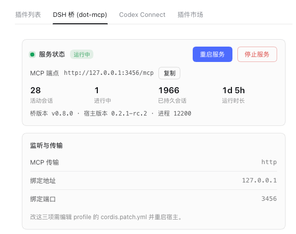

# dsh-dot-mcp

> **One local MCP endpoint onto DeepSeek Harness.** ChatGPT — desktop client,
> Codex, or plain chatgpt.com — creates tasks, continues sessions, starts and
> updates native goals, answers approvals, and reads results. DSH keeps the
> agent loop, tools, skills, subagents, sandbox, approvals, goal lifecycle and
> workspace security model.



The bridge connects the two sides. It does not replace DSH, modify DSH core, or
route DSH model traffic through ChatGPT.

## Usage paths

| Client | How it reaches the bridge | Notes |
| --- | --- | --- |
| **dot / Codex (local MCP client)** | direct `stdio`, or Streamable HTTP at `127.0.0.1:3456/mcp` | **best experience** — lowest latency, no tunnel |
| **ChatGPT web / desktop connectors** | OpenAI Secure MCP Tunnel (`tunnel-client`) → `127.0.0.1:3456/mcp` | same 22 tools; the tunnel daemon must stay running |

Both speak the identical stateless Streamable HTTP wire. The bridge has **no
token and no auth headers**: the listener is loopback-only and DNS-rebinding
protected (see [Security](#security)).

## Install

```bash
npm run build
dsh plugin --profile web add /path/to/this/tree
```

The profile pins `dsh-dot-mcp` as a `link:` dependency, so rebuilding this tree
refreshes it; the host must recompose (reload/restart) to load new code. This
tree is **v0.8.0** targeting DSH **0.2.1-rc.2**.

## The 22 tools

- **Sessions** — create, list (with `query`/`state`/`updated_after` search),
  inspect, continue, cancel, and delivery receipts (`dsh_message_status`).
- **Native goals** — every verb maps onto the host's own GoalService
  (`dsh_create_goal`/`dsh_revise_goal`/`dsh_pause_goal`/`dsh_resume_goal`/
  `dsh_stop_goal`), plus the long-poll wait plane (`dsh_wait_goal`,
  `dsh_wait_until_action_required`).
- **Human in the loop** — approvals and questions park verbatim for the remote
  driver while the host GUI is absent, and settle through `dsh_approve` /
  `dsh_answer_question`; the bridge keeps no policy of its own.
- **Evidence** — `dsh_get_result` (detail tiers + `total_max_chars` total
  budget), `dsh_get_session` / `dsh_get_result` / `dsh_get_task_status`
  snapshot markers, `dsh_health`, `dsh_credential_status`.
- **Workspace boundary** — one mutable session per workspace, idempotent
  `request_id` retries, no process killing on cancel.

The full tool effect matrix, module ownership and wire vocabulary live in
[ARCHITECTURE.md](ARCHITECTURE.md); the frozen tool names the real-boundary
tiers assert are in `test/integration/frozen-wire.mjs`.

## Configuration

| Key | Default | Meaning |
| --- | --- | --- |
| `transport` | `http` | `http` (Streamable HTTP) or `stdio` |
| `host` / `port` | `127.0.0.1` / `3456` | bind; non-loopback is refused unconditionally |
| `resultMaxChars` / `resultMaxItems` | `8000` / `50` | tool-result caps |
| `sessionMaxItems` / `sessionMaxChars` | `20` / `4000` | session-history caps |
| `logLevel` | `info` | bridge log verbosity |
| `autoApproveEscalations` | `false` | grant every escalation ask instead of parking it (unattended mode; grants are logged at `warn`) |
| `enabled` | `true` | master switch: off refuses all MCP traffic with 503 while `/status` stays reachable |

The budget/behavior rows are **volatile**: edit them live under
设置 → 内置插件 → "DSH 桥 (dot-mcp)" (the tab in the screenshot), written back
atomically to the profile `cordis.patch.yml` and applied without a restart.
That panel also shows live state (`GET /status`: sessions, uptime, versions),
and offers **restart / stop / resume** over `enabled`. `transport`/`host`/`port`
stay file-only by design — changing a listener always needs a restart.

## Security

- **No authentication.** Any local *process* that can reach
  `127.0.0.1:<port>` can drive all 22 tools. Browser pages are fenced by
  DNS-rebinding protection (non-loopback `Host`/`Origin` refused). If you put it
  behind a proxy or tunnel yourself, front it with your own auth.
- **No secret scrubbing.** Tool outputs and logs carry caller/agent text
  verbatim, and `dsh_credential_status` returns plaintext provider credential
  values. Connect nothing you would not hand your API keys to.
- **Approvals relay verbatim.** The host's own hooks decide what asks; when no
  GUI is attached, every question reaches the remote driver and its model.
  Whoever you connect as the MCP client *is* the approval authority.

## Verification tiers

| Tier | Command | What it proves |
| --- | --- | --- |
| Unit | `npm test` | 298 tests: synthetic contexts, isolated host-service fixtures |
| Release | `npm run test:release` | packs this tree, installs the tarball + official `dsh@0.2.1-rc.2` into a throwaway dir, runs the CLI lane and the real-host lane |
| Live | `BRIDGE_DSH_DIR=... npm run test:live` | boots a real harness checkout and asserts the served 22-tool vocabulary |
| Golden | `npm run test:golden` | drives all 22 frozen tools over the real wire against a living test instance (last measured: 87 pass · 0 fail, 22/22 happy path) |

## License

MIT. See [LICENSE](LICENSE).

---

**Unofficial community project. Not affiliated with or endorsed by OpenAI or DeepSeek.**
